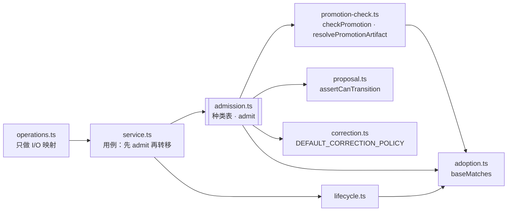

# Proposal 准入 module：按种类决定守卫（SKIL-186）

SKIL-186（父 issue SKIL-185，来源：架构扫描 SKIL-184 第 1 项，并入第 4 期 SKIL-178 第 4 项的前半）。基线 `origin/main` @ `4875010`，文中行号都按这个基线。本文只出设计，不写实现代码。

## 1. 现状

### 1.1 读了什么

- `CONTEXT.md`「Proposal 与台账」一节；ADR-0004、0006、0021、0024、0032（全文）。
- `docs/design/publication-crash-recovery.md` §2.2–2.3（`checkPromotion`、`publishPromotion` 的来历），`docs/design/derived-projection-module.md` 与 `specs/derived-projection-module/tasks.md`（T1–T5 与跨票顺序），`specs/tool-correction-create-skill/{requirements,tasks}.md`（R14–R16、Task 5 的 pattern-only accept gate）。
- `packages/skill-evolution/src/`：`service.ts`、`operations.ts`、`promotion-check.ts`、`errors.ts`、`workflow.ts`（全文）；`proposal.ts:1-60, 90-120, 190-243`、`lifecycle.ts:30-200, 300-330`、`correction.ts:1-40`、`evaluator.ts:40-70, 150-175`、`pattern-design.ts:60-115`、`adoption.ts`、`types.ts:140-200`、`index.ts`。
- 调用方：`packages/skill-evolution/bin/dsh-skill-evolution.mjs:12-16, 113-182`、`packages/dsh-bundle/index.js:4, 268-312`，二者只调 operations；`packages/dsh-adapter/tests/adapter.spec.ts:194-198` 直接调 `service.evaluate` / `acceptProposal` / `promote`。
- 在途 PR：#111（SKIL-174，`preparePromotion` / `publishPromotion`）、#113（SKIL-162，`service.ts` 大面积改写）的 diff；SKIL-163、174–177 的票面。
- 测试：`tests/operations.spec.ts`、`tests/task5.spec.ts`、`tests/publication-crash-recovery.spec.ts:378-443`。

### 1.2 种类判断散在哪里

「这是哪种 Proposal」靠 5 种信号判断：

| 位置 | 信号 | 用来做什么 |
|---|---|---|
| `service.ts:323-332` | `expectedBase.contentHash === 'absent'` | evaluate 的 Base 检查（在台账转移**之后**） |
| `service.ts:342` | 同上 | 给 evaluator 传 `baseContentHash: 'absent'` |
| `service.ts:377-381` | `source?.kind === 'pattern'` | accept gate（内联 if） |
| `service.ts:391-394` | `isPatternScopeAllowed` | promote 的 scope |
| `service.ts:403` | `status !== 'accepted'` | 与 `checkPromotion` 第 1 条重复 |
| `operations.ts:199-201` | `current.content !== baseContent` | stage 前的 Base 检查（只在 operations 有） |
| `operations.ts:219-225` | `'absent'` | evaluate 的 Base 检查（在转移**之前**） |
| `operations.ts:259-262` | `isPatternScopeAllowed` | promote 的 scope（第 2 份） |
| `promotion-check.ts:25-27` | `'absent'` | promote 的 Base 检查，含 version |
| `lifecycle.ts:324-330` | `'absent'` | 发布锁内的 Base 检查 |
| `adoption.ts:5-14` | 只比 name、hash | 公开导出，包内生产路径不调用（只有 `core.spec.ts:481-496` 测它）的第 6 份 Base 检查 |
| `correction.ts:12-15` | `operation === 'create-skill'`、`source.environmental` | scope 白名单 |
| `evaluator.ts:57, 163` | `baseContent.length === 0` | evaluator 的空 Base 约定 |
| `pattern-design.ts:78-88` | `baseContent === undefined` | 生产 create-skill Proposal |

生产路径上的 Base 检查实际有 5 份（service、operations 两处、promotion-check、lifecycle），另有公开导出的 `validateAdoptionBase` 一份，扫描报告记为 4 份。scope 2 份。

### 1.3 探针

在基线上写了临时测试（跑完已删），实际输出：

```
P1 service.evaluate, stale   {"name":"Error","code":null,"status":"evaluating"}
P2 evaluateProposal, stale   {"name":"OperationError","code":"stale-base","status":"proposed"}
P3 P1 之后恢复 Base 再评估   {"afterRestore":"evaluated"}
P5 普通 Proposal 门槛失败    {"gate":false,"accept":"accepted","dry":"gate-failed"}
P6 空用例                    {"operations":{"code":null,"status":"evaluating"},"service":{"code":null,"status":"evaluating"}}
```

- P1/P2 复现了父 issue 的分叉。卡在 `evaluating` 之后，只能等 Base 恢复后重评（P3），或者 reject / defer。
- P6 是新发现：用例校验（`service.ts:344`）也排在转移之后，两条路径都卡住，错误也都不带 code。
- P5 说明 accept gate 确实只对 pattern 生效：普通 Proposal 门槛失败也能 accept，到 promote 才被 `gate-failed` 挡住。这正是 SKIL-172 有意保留的行为（R15）。

另外做了两个改动探针（改完即 `git checkout`）：

- 在 `stageProposal` 里加 hash / absent 的 Base 检查：`Tests 300 passed (300)`。
- 再加 base version 检查：1 条失败，`publication-crash-recovery.spec.ts:378`「dry-run rejects a base version that real promotion rejects」。这条测试故意让 version 不符的 Proposal 一路走到 promote 才报 `stale-base`。所以 version 只在 promote 查，stage / evaluate 只比 hash。

### 1.4 在途改动

PR #111（draft，`MERGEABLE`）新增了 `service.preparePromotion`，把 scope、状态、artifact、`checkPromotion` 收在一起，dry-run 和真实路径都调它；operations 里的那份删掉了。它解决的是「两份 promote 守卫」，但种类判断仍然在 `isPatternScopeAllowed` 里。`publishPromotion` 先调 `preparePromotion`，再调一次 `checkPromotion`，所以同一组检查在真实路径上跑了两遍。

## 2. 设计问题与选项

### 2.1 种类怎么表示

| 选项 | 做法 | 复杂度 | 可测性 | 可逆性 / 迁移 |
|---|---|---|---|---|
| **A. 读取时派生（推荐）** | `proposalKind(proposal)` 按 `operation`、`source`、`expectedBase` 推出一个闭合联合；老记录缺 `operation` 时按规则补 | 一个纯函数 | 表驱动 | 不写台账，老记录不用迁移 |
| B. 持久化 `kind` 字段 | `SkillProposal` 加必填 `kind`，`createProposal` 写入 | 低 | 同 A | 改台账格式，违反本票约束和 ADR-0024；老记录要补字段；`kind` 与 `operation` / `'absent'` 会再次不一致 |
| C. 维持现状 | 各处继续看信号 | — | 每个信号单测 | 每加一种改约 8 个文件 |

B 被约束排除，C 正是要解决的问题。A 唯一的代价是派生规则本身成了「老记录怎么读」的契约，写进 ADR-0036。

### 2.2 准入 module 的形状

| 选项 | 做法 | 取舍 |
|---|---|---|
| **A. 纯函数加种类表（推荐）** | `admit(request)` 只做计算，不做 I/O；事实由 service 读好传进来。种类表 `KIND_POLICY` 是 module 私有常量 | in-process 依赖，按 DEEPENING 第 1 类直接合并测试，不需要 adapter。表驱动可以测完全部分支，不需要文件系统。代价是「先问准入再转移」要靠 service 每个方法的第一句来保证，由第 4 节的回归测试守住 |
| B. 带读取 port 的类 | `new ProposalAdmission(reader)`，自己读 current、artifact | 只有一个生产 adapter，port 是假想的 seam；测试还要写一个 in-memory reader，比直接传事实更啰嗦 |
| C. 准入包住台账 | `admitAndTransition(...)`，检查和转移一起做 | 结构上杜绝了「先转后查」。但 evaluate 要转两次，promote 的转移在 journal 收尾里（ADR-0032）。准入要么理解这两段流程，要么只包住一半，等于成了台账的第二个入口，和 ADR-0004「转移只有一个来源」冲突 |

推荐 A。可逆，采用默认答案，成员可推翻。

### 2.3 dry-run 与真实路径怎么共用

- **A. `preparePromotion` 作为唯一的 promote 准入入口（推荐）**：沿用 #111 的落点，把函数体换成一次 `admit({ stage: 'promote', ... })`。dry-run 和 `publishPromotion` 都调它，`publishPromotion` 不再单独调 `checkPromotion`。
- B. operations 和 service 各调一次 `admit`：调用点又变成两份，正是要去掉的形状。

推荐 A。可逆，采用默认答案，成员可推翻。

### 2.4 Base 规则住在哪

lifecycle 的检查必须留在发布锁内（ADR-0024、ADR-0032），而 `SkillVersionStore` 可以单独使用，不能反向依赖准入。

- **A. 叶子函数 `baseMatches(expected, current)` 放进 `adoption.ts`（推荐）**：lifecycle、准入、`validateAdoptionBase` 都调它。规则是「`'absent'` 当且仅当 current 不存在；否则 name 与 hash 都相等」，只有这一份。version 的检查只在准入的 promote 阶段做（见 1.3）。
- B. 准入导出 Base 检查，lifecycle 引用准入：准入要引 `CurrentSkill` 类型，lifecycle 又引准入，形成类型环，方向不对。
- C. 各留各的：就是现状。

推荐 A。签名是 `baseMatches(expected: AdoptionBase, current: { readonly name: string; readonly contentHash: string } | undefined): boolean`，lifecycle 传 `current.manifest`，`validateAdoptionBase` 传 `context.current`。后者的 `current` 是必填的 `SkillRef`（`types.ts:66-68`），所以它的行为不变：期望 `'absent'` 而 current 存在时照旧报 stale。可逆，采用默认答案，成员可推翻。

### 2.5 依赖方向



准入不依赖 service 和 lifecycle 的运行时，只用 `import type` 引 `CurrentSkill`。operations 不再依赖准入，也不再依赖 `promotion-check`、`correction`。这条依赖方向写进 ADR-0036。

## 3. 准入 module 的 interface（问题 1）

### 3.1 签名

```ts
// packages/skill-evolution/src/admission.ts（新）
export type ProposalKind = 'edit' | 'pattern-edit' | 'environmental-edit' | 'create-skill'

export type AdmissionRequest =
  | { readonly stage: 'stage'; readonly proposal: SkillProposal; readonly current: CurrentSkill | undefined }
  | { readonly stage: 'evaluate'; readonly proposal: SkillProposal; readonly current: CurrentSkill | undefined
      readonly cases: readonly SkillEvaluationCase[]; readonly policy?: EvaluationPolicyInput }
  | { readonly stage: 'accept'; readonly proposal: SkillProposal; readonly evaluations: readonly EvaluationArtifact[] }
  | { readonly stage: 'promote'; readonly proposal: SkillProposal; readonly current: CurrentSkill | undefined
      readonly evaluations: readonly EvaluationArtifact[]; readonly supplied?: SkillEvalResult | EvaluationArtifact
      readonly scope: PublicationScope; readonly policy?: EvaluationPolicyInput; readonly now: number }

export interface Admission {
  readonly kind: ProposalKind
  readonly to: ProposalStatus                    // 本阶段要转去的状态；promote 是 'promoted'，由 journal 收尾写入
  readonly evaluation?: {                        // 仅 evaluate：evaluator 两侧的输入
    readonly baseContent: string
    readonly candidateContent: string
    readonly baseContentHash?: 'absent'
  }
  readonly artifact?: EvaluationArtifact         // accept（种类要求时）、promote
  readonly effect?: 'publish-version'            // 仅 promote：发布要做什么，见第 9 节
}

/** 纯函数：不读写文件。不通过时抛带 code 的错误，见下面最后一条。 */
export function admit(request: AdmissionRequest): Admission
export function proposalKind(proposal: Pick<SkillProposal, 'operation' | 'source' | 'expectedBase'>): ProposalKind
export function isPatternScopeAllowed(proposal, scope, policy?): boolean  // 从 correction.ts 搬来，导出名和签名不变
```

- `isPatternScopeAllowed` 的入参只有 `operation`、`source`（`task5.spec.ts:48-56` 就是这样传的），没有 `expectedBase`。所以它不调完整的 `proposalKind`，只用 3.2 第 3–6 步推出种类，再查种类表的 `scopes` 一列。ADR-0024 的「当且仅当」检查只在 `admit` 里做。
- `checkPromotion` 留在 `promotion-check.ts`，签名不变，由 `admit` 的 promote 阶段调用。它的 Base 一条改成种类无关的写法：`baseMatches(proposal.expectedBase, current?.manifest)`、`artifact.baseContentHash === proposal.expectedBase.contentHash`，以及「current 存在、版本不是 `unversioned` 时必须等于 `baseVersion`」。三条对 create-skill 和 edit 的结果与今天相同，`'absent'` 的字面比较就从这个文件里消失了。
- 包入口 `index.ts` 对 `admission.js` 只具名导出 `isPatternScopeAllowed`，保持现有公开面不变。`admit`、`proposalKind`、`ProposalKind` 不从包入口导出，测试从 `../src/admission.js` 直接引。这样准入的 interface 以后可以改，不会牵动包外调用方。
- 事实全部由 service 读好传入，所以 `admit` 是 in-process 的 deep module：一个函数，背后是种类推断、种类表和四个阶段的守卫顺序。
- 不新增错误码。转移表不通过时照旧抛 `ProposalLedgerError('invalid-transition')`，service 今天就是这样，它本来就带 code。operations 把它映射成 `OperationError`，写法和 `reviewProposal` 现有的映射（`operations.ts:249-252`）一样。其余失败一律抛 `OperationError`，消息沿用今天的文本。

### 3.2 种类表

`proposalKind` 按顺序判断：

1. `operation` 是 `split`、`merge`、`retire`、`observe-only` → `invalid-option`（还没有守卫，不能当成普通 edit 混过去）。
2. `operation === 'create-skill'` 与 `expectedBase.contentHash === 'absent'` 只成立一个 → `invalid-option`（ADR-0024 的「当且仅当」，今天没有任何地方检查）。
3. `operation === 'create-skill'` → `create-skill`。
4. `source?.environmental === true` → `environmental-edit`。
5. `source?.kind === 'pattern'` → `pattern-edit`。
6. 其余（`edit-metadata`、`patch-content`，以及没有 `operation` 的老记录）→ `edit`。

| 种类 | Base（stage / evaluate） | Base（promote） | 允许的 scope | accept 前要求 passing artifact | evaluator 的 Base 一侧 |
|---|---|---|---|---|---|
| `edit` | current 存在，name、hash 相等 | 同左，另比 version（`unversioned` 除外）和 artifact 的 base hash | 全部 | 否，门槛在 promote 查 | current 正文 |
| `pattern-edit` | 同 edit | 同 edit | 全部 | **是**（SKIL-172 / R15） | current 正文 |
| `environmental-edit` | 同 edit | 同 edit | `CorrectionPolicy.allowedScopes`（默认 project、user） | 是 | current 正文 |
| `create-skill` | current 不存在 | current 不存在，artifact 的 base hash 为 `'absent'` | `CorrectionPolicy.allowedScopes` | 是 | `''`，并带 `baseContentHash: 'absent'` |

种类表是 `admission.ts` 私有的 `KIND_POLICY: Record<ProposalKind, KindPolicy>`。`Record` 是穷举的，`ProposalKind` 加一个成员而表里漏一行，就是编译错误。

```ts
interface KindPolicy {
  readonly base: 'present' | 'absent'
  readonly scopes: 'all' | 'correction-policy'
  readonly acceptNeedsPassingArtifact: boolean
  readonly validateCandidate: boolean            // promote 时是否做 Skill 文档与变更校验；现有四种都是 true
}
```

### 3.3 每个阶段的守卫顺序

顺序固定，写在 `admit` 里，dry-run 与真实路径走的是同一段代码。前一条不通过就不看后一条。

| 阶段 | 1 | 2 | 3 | 4 |
|---|---|---|---|---|
| stage | 种类（`invalid-option`） | 转移 `draft → proposed`（`invalid-transition`） | Base（`stale-base`） | — |
| evaluate | 种类 | 转移：`proposed → evaluating`，或 `evaluating / replayed / observed → evaluated`，按 ADR-0004 的表推出 | Base | 用例与 policy 校验（`invalid-option`） |
| accept | 种类 | 转移 `→ accepted` | 种类要求时：artifact 存在（`evaluation-missing`），且 artifact 与 result 都过门槛（`gate-failed`） | — |
| promote | 种类 | scope（`scope-not-allowed`） | `resolvePromotionArtifact`（`evaluation-missing` / `evaluation-mismatch`） | `checkPromotion`，内部顺序不变：状态、归属、Base 加 version、candidate hash、policy、过期、caseIds、门槛、文档校验 |

- accept 选 artifact 的规则沿用 `service.ts:378`：该 root 最新一条，不看过期。「选哪条、怎样算绑定」属于扫描第 2 项的 gate module（第 8 节）。
- evaluate 阶段的 Base 只比 hash，不比 version（1.3 的探针）。
- 不进准入的检查：
  - 「已发布即成功」（latest 已是 `promoted`）和「pending journal 是本 root 时豁免检查」，属于 ADR-0032 的恢复协议，由 service 判断，排在 `admit` 之前。dry-run 和真实路径都这样排。#111 里 `preparePromotion` 先查 scope 再查 replay，`publishPromotion` 先 replay，两条顺序不一致，切片 S-D 顺手对齐。
  - stage 的幂等重放（同 id、同内容就返回已有记录，`service.ts:308-312`）也排在 `admit` 之前。
- reject、defer、rollback 不经过准入。它们与种类无关，只受转移表和 ADR-0032 的台账守卫约束。

## 4. 调用顺序（问题 2）

### 4.1 service 的每个推进台账的方法，第一件事都是问准入

```ts
async evaluate(proposal, cases, runner) {
  const admission = admit({ stage: 'evaluate', proposal, current: await this.versions.readCurrent(proposal.skillName), cases, policy: this.options.evaluationPolicy })
  const evaluating = admission.to === 'evaluating' ? (await this.ledger.transition(proposal, 'evaluating', ...)).record : proposal
  const result = await evaluateCandidate({ ...admission.evaluation!, cases, runner, ... })
  // 写 artifact、转 evaluated，与今天相同
}
async stageProposal(proposal)   // 幂等重放 → admit('stage') → transition('proposed') → writeCandidate
async acceptProposal(proposal)  // admit('accept') → transition('accepted')
async preparePromotion(...)     // 已发布 / pending 豁免 → admit('promote')；dry-run 与 publishPromotion 共用
```

结果：stale Proposal 不再卡在 `evaluating`，台账停在 `proposed`，错误是 `OperationError('stale-base')`。runner 本身抛错时 Proposal 仍会停在 `evaluating`：转移已经发生，这是「评估开始过」的事实，可以从 `evaluating` 重评，不属于本票。

### 4.2 直接调 service 的回归测试

新文件 `tests/proposal-admission.spec.ts`。每条都直接调 service，不经 operations。断言三件事：错误 `code`、`service.proposals.readAll()` 的条数和最新状态、`service.evaluations.readAll()` 的条数。每条测试都按项目惯例用删校验法证明：撤掉对应实现（或把 `admit` 挪回转移之后），测试必须失败。

| # | 场景 | 期望 | 今天 |
|---|---|---|---|
| R1 | `edit`，current 被改过，`service.evaluate` | `stale-base`；最新仍是 `proposed`，没有 `:evaluating` 记录，没有 artifact | 普通 `Error`，卡在 `evaluating`（P1） |
| R2 | `create-skill`，目标 Skill 已存在，`service.evaluate` | 同 R1 | 同 R1 |
| R3 | `edit`，current 被删，`service.evaluate` | 同 R1 | `cannot evaluate without a current Skill`，卡住 |
| R4 | 空用例、重复 id、非法 category / severity，`service.evaluate` | `invalid-option`，台账不动 | 普通 `Error`，卡住（P6） |
| R5 | 已 `accepted` 的记录再 `service.evaluate` | `ProposalLedgerError('invalid-transition')`，台账不动；经 operations 是 `OperationError('invalid-transition')` | 相同，锁住现状 |
| R6 | R1 之后恢复 Base 再评估 | 正常 `proposed → evaluating → evaluated` | — |
| R7 | 同一 stale Proposal 分别走 `service.evaluate` 与 `evaluateProposal` | code 与台账结果完全相同 | 不同（P1 / P2） |
| A1 | `pattern-edit` 没有 artifact，`service.acceptProposal` | `evaluation-missing`，没有 `accepted` 记录 | 已有（`task5.spec.ts:34-46` 覆盖门槛失败） |
| A2 | `edit` 门槛失败，`service.acceptProposal` | 照常 `accepted`；之后 promote 报 `gate-failed` | 同（P5），锁住 SKIL-172 的行为 |
| A3 | `create-skill` 没有 `source`，没有 artifact | `evaluation-missing` | 今天能 accept（行为变化，见第 12 节） |
| S1 | stale `edit`，`service.stageProposal` | `stale-base`；没有候选目录，没有台账记录 | 能 stage |
| S2 | `operation: 'retire'`，`service.stageProposal` | `invalid-option` | 能 stage，后面当普通 edit 发布 |
| S3 | `operation: 'create-skill'` 但 hash 不是 `'absent'`（反之亦然） | `invalid-option` | 能 stage |
| P1 | 表驱动：四种种类 × {dry-run, 真实} × {scope 允许 / 不允许, stale, 门槛失败, 正常} | dry-run 与真实路径的 code 两两相同；失败行没有任何写入 | 由 #111 部分覆盖 |
| K1 | `proposalKind` 表驱动，含没有 `operation` 的老记录 | 按 3.2 的顺序 | — |
| L1 | 架构守卫：`'absent'` 比较、`=== 'create-skill'`、`source?.kind === 'pattern'`、`environmental === true` 只出现在白名单文件 | 白名单是 `admission.ts`、`adoption.ts`、`pattern-design.ts`（生产方）、`types.ts`。只禁止判断，不禁止拷贝字段值（例如 `lifecycle.ts` 写 journal 时的 `from.contentHash`） | — |

L1 是「新种类只改准入」的机械保证。`evaluator.ts` 的 `baseContent.length === 0` 不在禁用列表里，理由见第 5 节。

## 5. dry-run 与真实路径共用守卫；现有判断逐条归属（问题 1、3）

operations 收尾后的样子：每个维护函数只做「解析 `proposalRef` → 读文件 → 调一个 service 方法 → 写报告和 artifact 文件 → 映射错误」（ADR-0006）。`assertScope` 留着，它把字符串解析成 `PublicationScope`，属于输入映射。`assertTransition` 删掉。import 里的 `assertCanTransition`、`checkPromotion`、`isPatternScopeAllowed`、`DEFAULT_CORRECTION_POLICY`、`createContentHash` 都不再需要。

| 现有位置 | 归到哪里 | 说明 |
|---|---|---|
| `service.ts:323-332` | `admit` evaluate 第 2、3 步 | 挪到转移之前 |
| `service.ts:333, 344` | `admit` evaluate 第 4 步 | `validateEvaluationCases` 暂时搬进 `admission.ts`。它和 `evaluator.ts:136-144` 的漂移留给 gate module |
| `service.ts:342` | `Admission.evaluation.baseContentHash` | service 不再自己判断 `'absent'` |
| `service.ts:377-381` | `admit` accept 第 3 步，由 `acceptNeedsPassingArtifact` 决定 | 第 6 节 |
| `service.ts:391-394` | `admit` promote 第 2 步 | #111 已搬进 `preparePromotion`，再换成种类表 |
| `service.ts:403` | 删 | 与 `checkPromotion` 第 1 条重复 |
| `operations.ts:196-201` | 删，由 stage 的 Base 检查兜住 | `readCurrentUnlocked` 总是按正文重算 hash（`lifecycle.ts:57-75`），比 hash 和比正文等价。`baseVersion` 的默认值改成 `options.baseVersion ?? current?.manifest.version ?? 'unversioned'`，这是输入映射 |
| `operations.ts:219-225` | 删 | 由 evaluate 准入兜住；R7 证明两条路径结果相同 |
| `operations.ts:259-262` | 已由 #111 删除 | — |
| `promotion-check.ts:18-54` | `checkPromotion` 留在原处，由 `admit` 调用；Base 一条改成种类无关的写法（3.1） | 少搬一个文件，也少和 #111、SKIL-175–177 冲突 |
| `lifecycle.ts:324-330` | 留在锁内，改调 `baseMatches` | 锁内复查是 ADR-0024 要求的「同名并发创建报 stale」 |
| `adoption.ts:5-14` | 改调 `baseMatches` | 导出签名和行为都不变 |
| `correction.ts:12-15` | `isPatternScopeAllowed` 搬进 `admission.ts`，按种类表的 `scopes` 实现 | 包入口照旧导出；`DEFAULT_CORRECTION_POLICY` 仍在 `correction.ts` |
| `evaluator.ts:57, 163` | 不动 | 这是 evaluator 自己的输入约定（`''` 表示没有这个 Skill），`evaluateCandidate` 被测试直接调用。种类知识不再流进 evaluator，准入只是按约定把 `''` 传给它 |
| `pattern-design.ts:78-88` | 不动 | 生产方，按 ADR-0024 写字段。写错由 stage 准入报 `invalid-option`（S3） |
| `proposal.ts:241` | 不动 | `changedSurfacesFor` 按 Diagnosis 的 operation 选 surface，不是守卫。`switch` 是穷举的 |
| `types.ts:148-149, 178-181` | 不动 | ADR-0024 的数据格式 |

收敛结果：stale-base 规则从 6 份收成 1 份 `baseMatches`，version 一条只在 `checkPromotion` 里。scope 从 2 份收成种类表里的 1 份。真实路径上重复跑的那次 `checkPromotion` 去掉。

## 6. pattern-only accept gate 保留并搬家（问题 4）

规则原样保留：普通 Proposal accept 不看 artifact，门槛留到 promote；pattern 来源的 Proposal 没有 passing artifact 就不能 accept（R15、`specs/tool-correction-create-skill/tasks.md:82`）。它从 `service.ts:377` 的内联 if 变成种类表里的一列 `acceptNeedsPassingArtifact`：`edit` 为 `false`，其余三种为 `true`。A1、A2 两条测试把两边都锁住，有人把 `edit` 改成 `true` 或把 pattern 改成 `false`，都会失败。

唯一的收紧在 `create-skill`：今天的条件是 `source?.kind === 'pattern'`，没有 `source` 的 create-skill 能不评估就 accept。改成按种类后，create-skill 一律要求 artifact。没有任何生产路径会造出这种 Proposal（只有 `pattern-design.ts` 生产 create-skill，而且总带 `source`），见第 12 节。

## 7. 「用例只走 facade」（问题 5）

第 4 期第 4 项有两半：

- **前半：守卫在 operations 和 service 各一份，`--dry-run` 只走较松的那份。**本设计把它收掉了。CLI 和 bundle 本来就只调 operations（1.1），operations 只调 service，service 每个推进台账的方法第一步都问准入。所以不管从 operations 进来，还是像 `adapter.spec.ts:194-198` 那样直接调 service，走的都是同一份守卫；dry-run 走的是 `preparePromotion`，和真实路径同一份。这里的「facade」就是 service 的用例方法，不新建类：ADR-0006 已经否决了 facade 类和命令分发器，本设计不加。
- **后半：failures 报告由 CLI 和 bundle 各自拼装。**这就是扫描第 3 项，不在本票范围（见第 8 节）。

## 8. 范围外两项以后挂在哪

- **扫描第 2 项：gate module。**挂在准入的三个调用点上：
  - accept 第 3 步，「这条 artifact 算不算 passing」；
  - evaluate 第 4 步，用例与 policy 校验（届时 `validateEvaluationCases` 和 `evaluator.ts:136-144` 合成一份）；
  - promote 第 4 步，`checkPromotion` 里的证据绑定（归属、candidate hash、policy、过期、caseIds、门槛）。

  分工是：种类表决定「这个种类在这个阶段要不要证据」，gate module 决定「证据怎样算成立」。gate module 换掉的是这三处的实现，`admit` 的签名和种类表都不用变。`Admission.evaluation` 给 evaluator 的两侧输入，也是 gate module 以后的输入边界。
- **扫描第 3 项：failures 报告用例。**它是一个只读用例，不推进台账，和准入没有接口关系。按 ADR-0006 在 operations 补一个函数即可。

## 9. 走一遍：新增 retire 只改准入

以 ADR-0024 写定的「create-skill 的撤销走 retire」为例，加守卫只改 `admission.ts`：

```ts
export type ProposalKind = 'edit' | 'pattern-edit' | 'environmental-edit' | 'create-skill' | 'retire'   // +1 个成员
// proposalKind 第 1 步：'retire' 从「还没有守卫」里拿出来，改成 → 'retire'                          // 改 1 行
// KIND_POLICY：Record 穷举，不加这一行就编译失败
retire: { base: 'present', scopes: 'all', acceptNeedsPassingArtifact: true, validateCandidate: false },
// evaluate 的两侧输入：Base 一侧是 current 正文，Candidate 一侧是 ''（「没有这个 Skill」）
// promote 的 effect：'retire-skill'
```

测试只在 K1 和 P1 的表里各加一行。逐个文件核对：

| 文件 | 要不要改守卫 | 原因 |
|---|---|---|
| `admission.ts` | 改 | 上面几行 |
| `service.ts` | 不改 | 只调 `admit`，不看种类 |
| `operations.ts` | 不改 | 不再有守卫 |
| `promotion-check.ts` | 不改 | 证据比对与种类无关 |
| `lifecycle.ts`、`adoption.ts` | 不改 | `baseMatches` 与种类无关 |
| `correction.ts` | 不改 | scope 规则已在种类表 |
| CLI、bundle | 不改 | 只调 operations |

今天加同样的守卫要改约 8 个文件（1.2 的表）。

守卫之外，retire 还需要两样新能力。它们不是守卫，也不归准入管，这里写明，免得以后被当成「免费」：

1. **Candidate 为空的评估。**`evaluator.ts` 今天会把无效的 candidate 直接判失败，「删掉这个 Skill 之后会怎样」需要 gate module / evaluator 支持空 Candidate 一侧。准入的 interface 已经按两侧输入（`Admission.evaluation`）定好，不用再改。
2. **retire 的发布动作。**retire 不写新版本，而是把 Skill 标成 `retired` 并移出 live，publication / lifecycle 要新增这个动作，可能还要一种新的 journal operation（ADR-0032 的数据格式）。service 按 `admission.effect` 分派，不自己看种类；新增的 `'retire-skill'` 分支由 publication 实现。

split、merge 要多个 Base，`AdoptionBase` 只能表示一个 Skill，属于台账格式变更，要另立 ADR，不在本票范围。种类表的形状不挡它们，到时候 `base` 一列扩成多 Base 即可。

## 10. 与在途票的先后与冲突（问题 6）

| 在途 | 碰到的位置 | 冲突性质 | 落点与顺序 |
|---|---|---|---|
| SKIL-174 / PR #111（draft，`MERGEABLE`） | `preparePromotion`、`publishPromotion`、`operations.promoteProposal` | 语义相关：#111 建立了 promote 守卫的唯一入口 | **#111 先合**。S-D 在它之上，只改 `preparePromotion` 的函数体，再去掉 `publishPromotion` 里第二次 `checkPromotion`。journal、锁、错误分类（`publication-conflict`）都不碰 |
| SKIL-175/176/177（backlog，等 #111） | 测试文件；`publishPromotion` / `repair` 的锁与 journal 收尾 | 同一段 `service.ts` 的文本相邻，语义无交集 | 与 S-D 并行。各自的测试文件独立，`service.ts` 的文本冲突由后合的一方解。ADR-0032「锁内做唯一一份晋升校验」的位置由 SKIL-122 决定；S-D 只把那一处换成 `admit`，不挪位置 |
| SKIL-162 / PR #113（draft，`MERGEABLE`） | `service.ts` 大面积重排格式，含 `evaluate`、`acceptProposal`、`promote` 的文本 | 纯文本冲突：#113 改的是投影，不改这几个方法的语义 | 不互相等。`specs/derived-projection-module/tasks.md` 已规定 #113 先于投影 T2–T5。本票切片照同一规则：与 #113 谁后合谁解冲突，后合的一方按合并后的 `main` 重新定位行号 |
| SKIL-179 / SKIL-183 投影 T2–T5 | 构造函数、`refreshDerived`、`proposeChange`、`proposePattern` | 不相交：准入不读投影，投影不推进台账。`proposePattern` 最后一步调 `stageProposal`，S-C 在 `stageProposal` 里加准入，不改 `proposePattern` | 并行。沿用 tasks.md 对 SKIL-173 的约定：`service.ts` 的文本冲突由后合的一方解 |
| SKIL-131 / SKIL-163（backlog，排在 T5 之后） | `proposeFromRecords`、`isClusterReadyForProposal` | 不相交：那是「cluster 证据够不够生成 Proposal」，发生在 Proposal 存在之前；准入管的是 Proposal 生成之后的生命周期 | 并行。以后如果要加「少数派 cluster 生成的 Proposal 不能 stage」这类规则，挂在种类表的 stage 一列，不另开路径 |
| SKIL-172（done） | pattern-only accept gate | — | 规则原样保留，见第 6 节 |

合并顺序：S-A 现在就能开工（只新增文件、改叶子 module）→ S-B、S-C 并行 → S-D 等 #111 合并后开工 → S-E 最后。都是可逆的排期默认，采用默认答案，成员可推翻。

## 11. 切片（问题 7，给 S2 Spec Writer）

| 切片 | 依赖 | 范围 | 验收（测试编号见 4.2） |
|---|---|---|---|
| **S-A 准入 module** | 无 | 新建 `admission.ts`：`ProposalKind`、`proposalKind`、`KIND_POLICY`、`admit`。`isPatternScopeAllowed` 从 `correction.ts` 搬进来（导出名和签名不变，不留 re-export 桩，`index.ts` 改从 `admission.js` 具名导出），`validateEvaluationCases` 从 `service.ts` 搬进来。`adoption.ts` 加 `baseMatches`，`lifecycle.ts:324-330`、`validateAdoptionBase`、`checkPromotion` 的 Base 一条改调它 | K1；`admit` 表驱动覆盖 4 阶段 × 4 种类的每个错误码；`publication-crash-recovery.spec.ts:410-443`、`task5.spec.ts` 原样通过 |
| **S-B evaluate** | S-A | `service.evaluate` 先 `admit` 再转移，用 `Admission.evaluation` 构造 evaluator 输入。删 `operations.ts:219-225` 和 `assertTransition` | R1–R7 |
| **S-C stage 与 accept** | S-A | `stageProposal`：幂等重放 → `admit('stage')` → 转移。`acceptProposal`：`admit('accept')` 替换 `service.ts:377-381`。删 `operations.ts:196-201`，`baseVersion` 改用 5 节的默认值 | S1–S3、A1–A3；`operations.spec.ts:67-79`（stale base 不写候选目录和台账）原样通过 |
| **S-D promote** | S-A、#111 合并 | `preparePromotion` 的函数体：已发布 / pending 豁免 → `admit('promote')`。`publishPromotion` 只问一次准入。dry-run 的 replay 顺序与真实路径对齐 | P1；#111 新增的测试原样通过 |
| **S-E 收口** | S-B、S-C、S-D | L1 架构守卫；清理 operations 不再用的 import | L1；三个包的 build / test |

S-B、S-C 改的是 `service.ts` 里不同的方法、`operations.ts` 里不同的函数，可以并行合。每张实现票都跑 core、adapter、bundle 的 build 和 test，并贴实际输出。

## 12. 行为变化

以下变化都会被包外直接调 service 的调用方看到，所以列进 ADR-0037：

| 方法 | 今天 | 之后 |
|---|---|---|
| `service.evaluate` | stale、缺 current、用例非法时抛普通 `Error`，台账已到 `evaluating` | 抛 `OperationError`（`stale-base` / `invalid-option`），台账不动 |
| `service.stageProposal` | 不查 Base，不查 operation | stale 报 `stale-base`；`split` / `merge` / `retire` / `observe-only`，以及违反 ADR-0024「当且仅当」的记录，报 `invalid-option`。两种情况都不写台账和候选目录 |
| `service.acceptProposal` | 只有 `source.kind === 'pattern'` 要求 artifact | create-skill 不管有没有 `source` 都要求 |
| `operations.evaluateProposal` | 只放行 `proposed`、`evaluating`；`replayed`、`observed` 报 `invalid-transition`（`operations.ts:219-221`） | 按转移表放行，与 service 一致。今天没有任何生产路径能进入这两个状态（`src/` 里没有写入它们的代码），实际影响为零 |
| 其余 `operations.*` | — | 对外的 code 和文件写入都不变（R7、`operations.spec.ts`、`task5.spec.ts` 守住） |

1.3 的探针说明，stage 加上 Base 检查之后，现有 300 条测试全部通过。`stageProposal` 拒绝 `retire` 等 operation，会挡住一个 Designer 自己在 `ProposalInput` 里写 `operation: 'retire'` 的 Proposal。今天这样的 Proposal 会被当成普通 edit 一路发布出去，挡住是对的。

`CONTEXT.md` 要不要收「Proposal kind」这个词条，留给 S2 决定。本 PR 按验收标准只改 `docs/**`。

## 13. 不可逆决策

两条都是 `status: proposed`，等成员确认。确认后在本 PR 里改成 `accepted`。

- **ADR-0036**：Proposal 种类在读取时由准入 module 从现有字段推出，不持久化。按种类的守卫只写在这个 module 里。依赖方向是 operations → service → admission → 叶子 module，lifecycle 只共享叶子 `baseMatches`。
- **ADR-0037**：service 里推进台账的用例都先问准入、再转移。由此带来第 12 节列出的 service 公开行为变化。

## 14. 与已有 ADR 的关系

没有冲突，逐条核过：

- **ADR-0004**：不加状态、不加转移。准入只调 `assertCanTransition` 读转移表，不另写一份转移规则。
- **ADR-0006**：operations 收成薄 adapter，不建 facade 类或命令分发器。
- **ADR-0021**：record id、`conflict` 的判定都不变。
- **ADR-0024**：`'absent'` 哨兵和台账格式不变。「当且仅当」从一句约定变成准入里的检查。锁内的 Base 复查留在 lifecycle。
- **ADR-0032**：journal、锁、收尾、隔离都不变。「锁内做唯一一份晋升校验」的位置不变，只把调用换成 `admit`；「已发布即成功」和 pending 豁免仍由 service 在准入之前判断。
